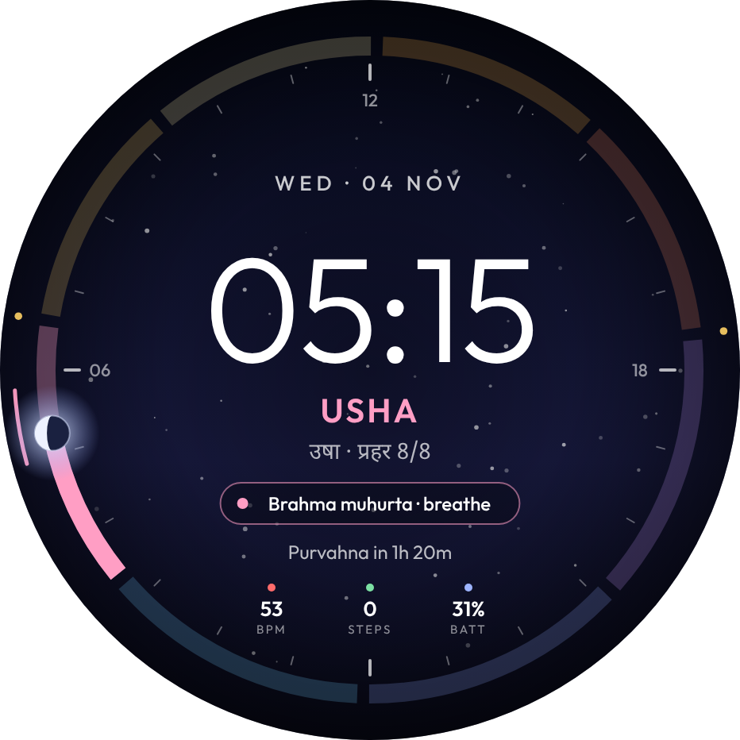
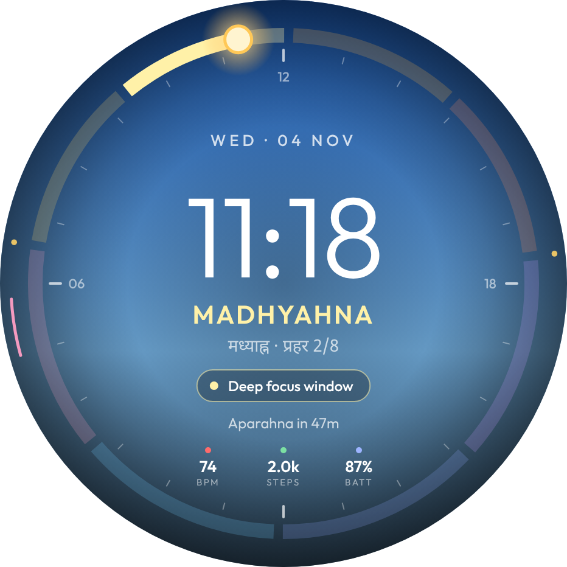
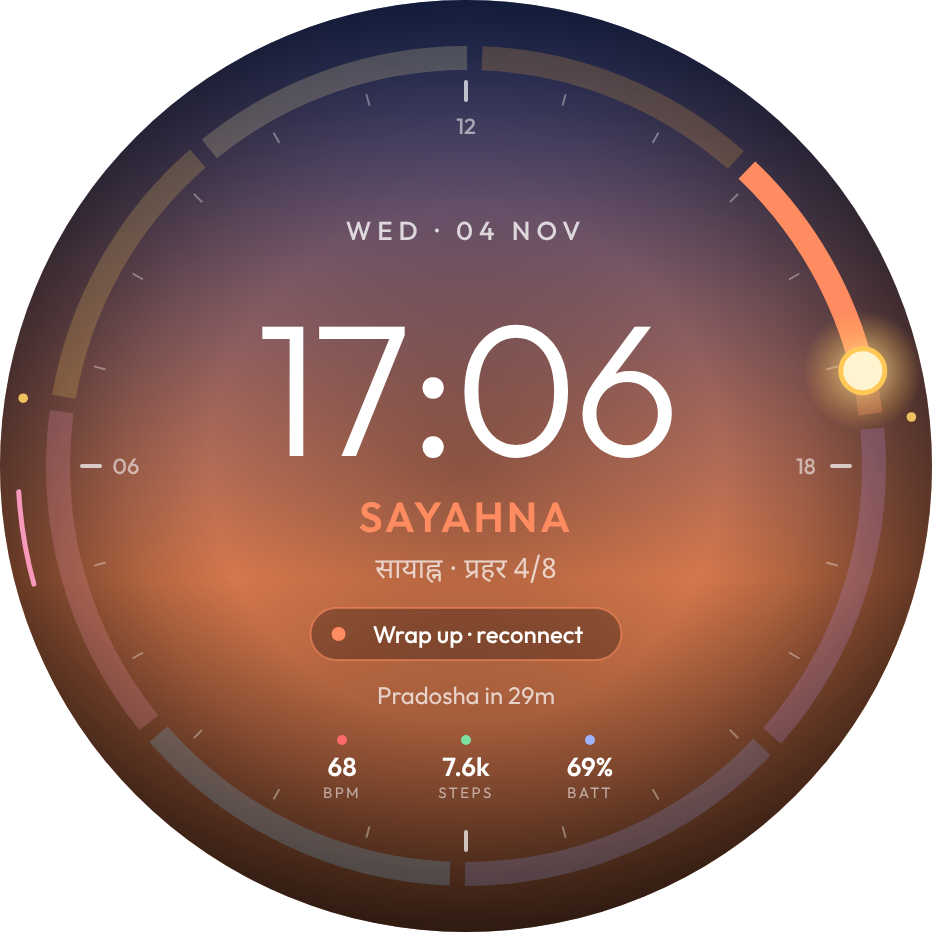
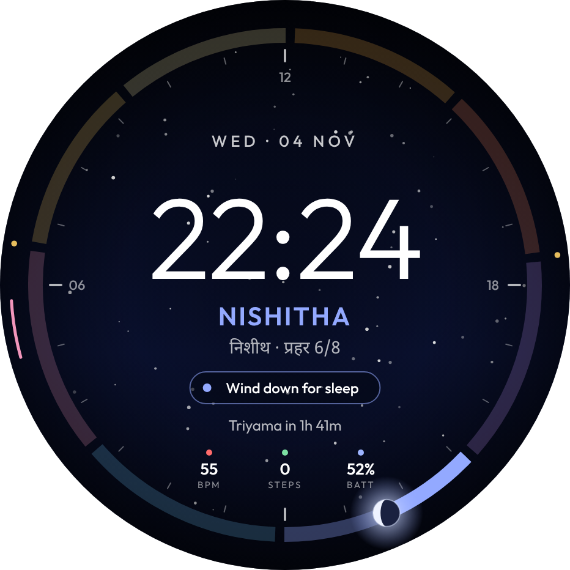
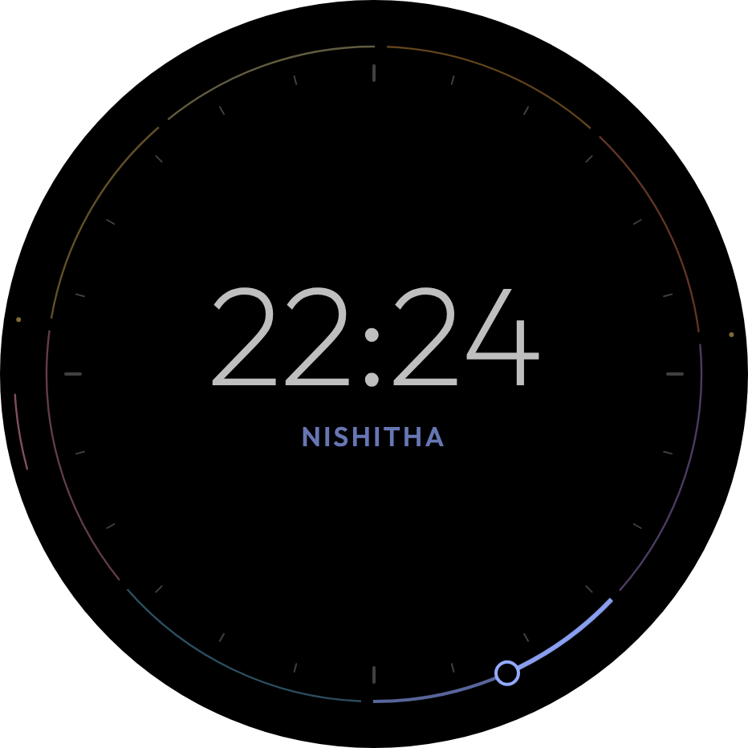
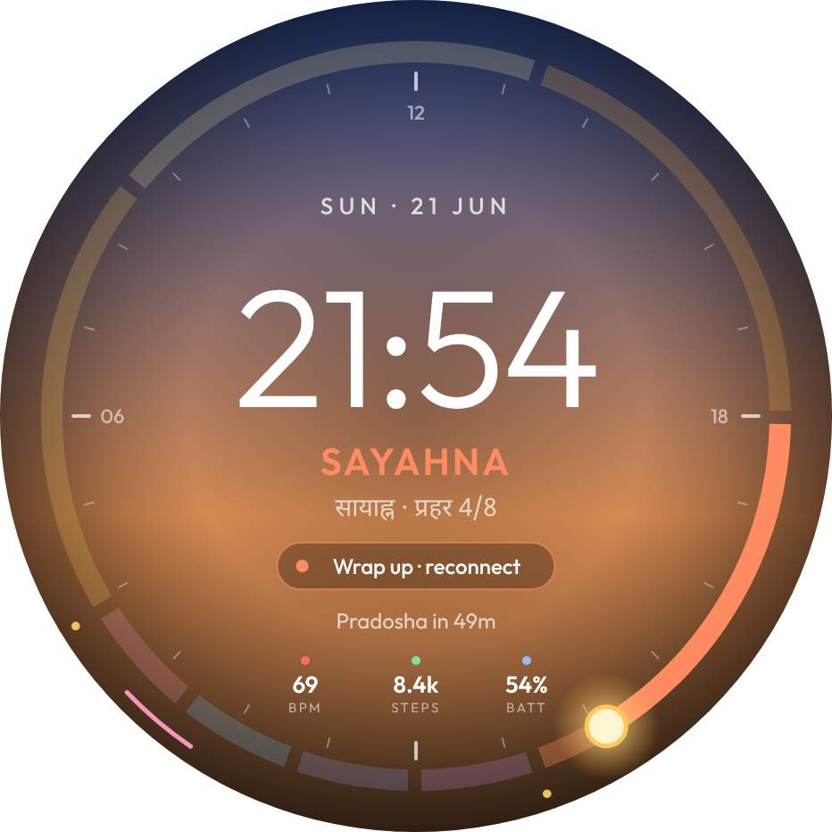
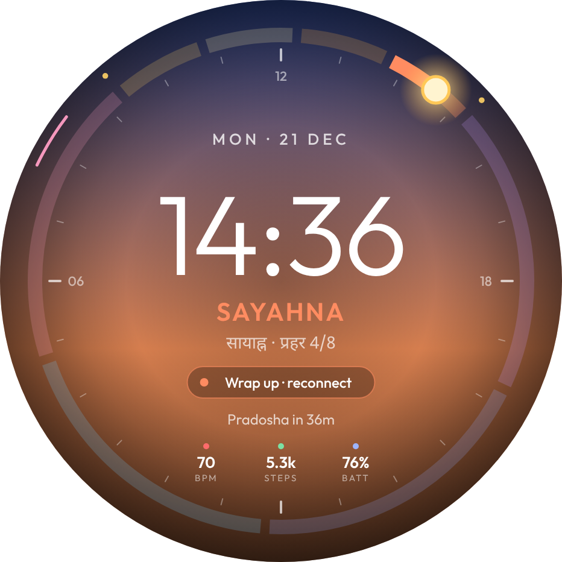

# PRAHAR · प्रहर

**A living 24-hour watch face that tells time the way India once felt it.**
Entry for the *Titan Watch Face Design Challenge 2026 · Open Innovation* track: *"Think freely. Design boldly. Innovate beyond the dial."*


## The idea in one line
Every watch tells you *what time it is*. PRAHAR also tells you *what kind of time it is*. It splits your day into the eight traditional Indian **prahars**, computes them from **your real sunrise and sunset**, and pairs each one with a gentle circadian nudge.

## What makes it new
| | |
|---|---|
| **A dial that breathes** | Prahars are 4 equal parts of daylight + 4 equal parts of night, so the segments change length every day. Oslo midsummer: daylight prahars ≈ 4h 40m. Oslo midwinter: ≈ 1h 30m. No two days look the same. |
| **The sky is the hand** | No hands, no 12-hour circle. A sun (by day) or moon (by night, **in its real phase**) travels a 24-hour ring: noon at the top, midnight at the bottom. |
| **Living background** | The gradient follows the actual sky: indigo pre-dawn → rose dawn → blue noon → golden hour → stars. |
| **Heritage × wellness** | Each prahar carries a nudge (Madhyahna → *Deep focus*, Aparahna → *Hydrate · walk*, Pradosha → *Unplug*). Brahma muhurta is marked on the bezel. Coaching with zero notifications. |
| **Bilingual** | English ⇄ हिंदी with a single tap. Designed to localise to any Indian language. |
| **Battery-aware AOD** | Always-on mode uses thin outlines on true black with no fills, which keeps the panel cool and avoids burn-in. |

## The eight prahars
| # | Prahar | | Nudge |
|---|---|---|---|
| 1 | Purvahna | पूर्वाह्न | Move · plan the day |
| 2 | Madhyahna | मध्याह्न | Deep focus window |
| 3 | Aparahna | अपराह्न | Hydrate · take a walk |
| 4 | Sayahna | सायाह्न | Wrap up · reconnect |
| 5 | Pradosha | प्रदोष | Unplug · family time |
| 6 | Nishitha | निशीथ | Wind down for sleep |
| 7 | Triyama | त्रियामा | Deep rest |
| 8 | Usha | उषा | Rise · breathe (Brahma muhurta) |

## Renders (466 × 466 round AMOLED, @2x)
| Usha · 05:15 | Madhyahna · 11:18 | Sayahna · 17:06 | Nishitha · 22:24 |
|---|---|---|---|
|  |  |  |  |
| **Always-on** | **हिंदी** | **Oslo · 21 Jun** | **Oslo · 21 Dec** |
|  |  |  |  |

## Run the interactive prototype
```bash
python3 -m http.server 8123
```
Then open http://localhost:8123. Try **Play a day**, **Play a year** (watch the prahars breathe), **Always-on**, tapping the face for हिंदी, and switching the city to Oslo.

URL params for direct states: `?t=17.1&doy=308&city=oslo&aod=1&lang=hi`.

## Regenerate the renders
```bash
node scripts/export.cjs http://localhost:8123/
```
Writes `exports/face-*.png` plus showcase screenshots (needs Playwright + Chromium).

## Feasibility
- **Offline:** sunrise and sunset come from the NOAA solar approximation in ~20 lines of math (`src/face.js`). Location is read once from the paired phone, with no GPS polling.
- **Pure vector:** arcs, text and gradients only, so it maps directly to Watch Face Format / Watch Face Studio and similar smartwatch face pipelines.
- **Low cost to run:** the face redraws once a minute; AOD draws under 5% lit pixels.

## Files
- `src/face.js`: face engine (solar math, prahar calculation, moon phase, SVG renderer)
- `src/app.js`: showcase controls (live / play day / play year / manual, AOD, language, city)
- `index.html`: showcase and pitch page
- `exports/`: submission-ready PNGs
