# Encore.

**A watch face that knows what you love.** It notices what you're watching, gifts you a face made for it, and designs one from a sentence.

Entry for the *Watch Face Design Challenge 2026 · Open Innovation*: *"Think freely. Design boldly. Innovate beyond the dial."*


## The experience
| Gift reveal | Your face | Swipe to browse | Describe it |
|---|---|---|---|
| 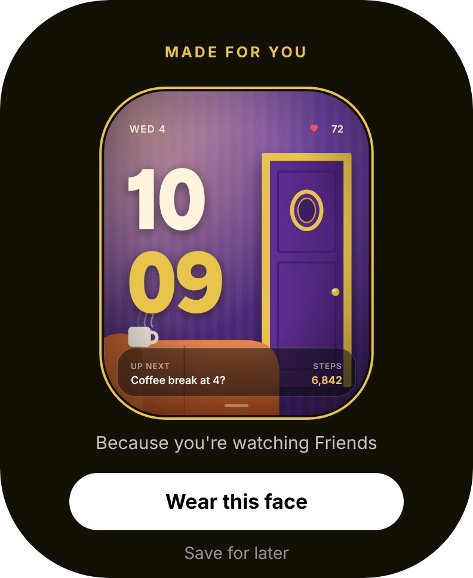 | 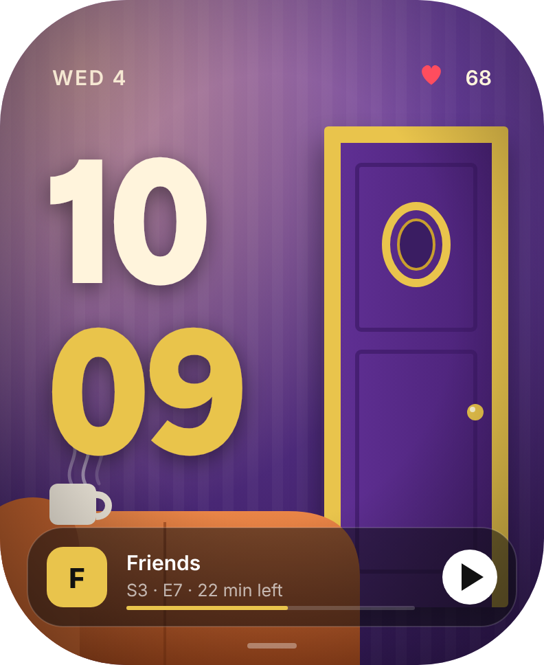 | 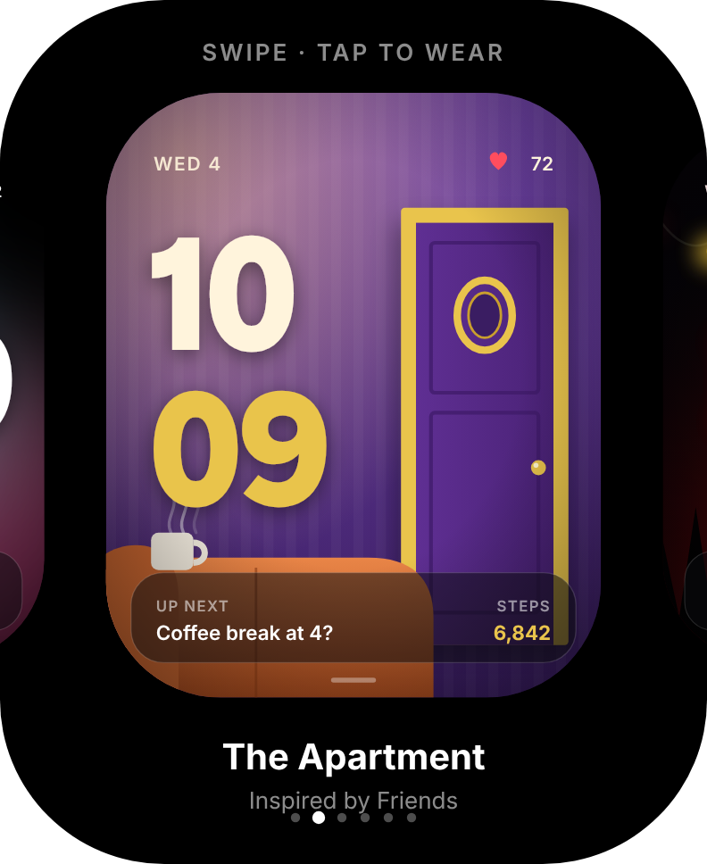 | 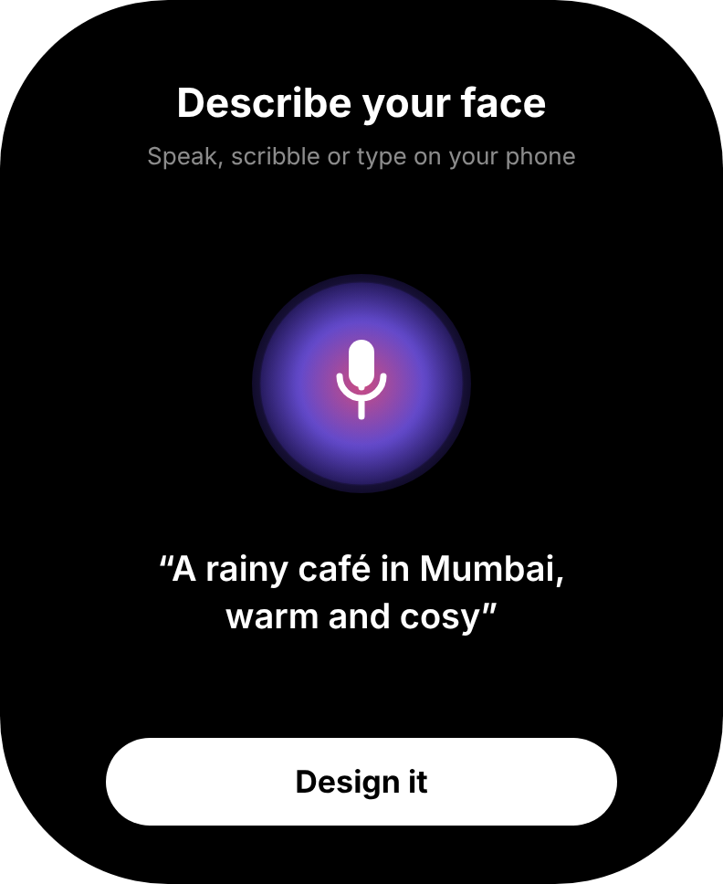 |

1. **Notice:** the Encore phone app sees what's playing on Netflix, Prime Video and similar apps (on Android, through the system's media controls, with your permission). It builds a **private taste profile on the phone**.
2. **Gift:** when a show becomes a real favourite, the watch shows **"Made for you · Because you're watching Friends"**. The face is revealed with a light sweep. *Wear this face* or *Save for later*.
3. **Live complication:** the face carries your show: episode, minutes left, and a resume button that hands off to the TV.
4. **Swipe:** a horizontal swipe opens your face carousel. The last card is **+ Create your own**.
5. **Describe:** say or type *"a rainy café in Mumbai"*. Encore composes the wallpaper, palette, typography and layout, then gifts it back.
6. **Heart sync:** heart rate pulses live on every face. A racing heart makes the screen edge glow red on each beat, and a sudden spike brings up a breathing guide.

## The collection
| Studio | The Apartment | Upside | The Vault | The Game |
|---|---|---|---|---|
| 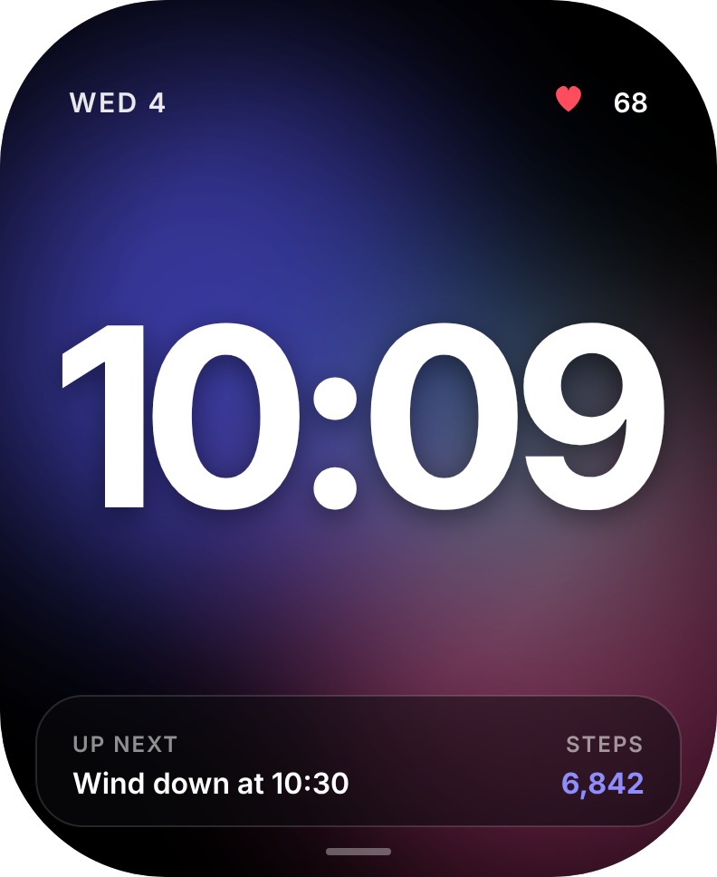 |  | 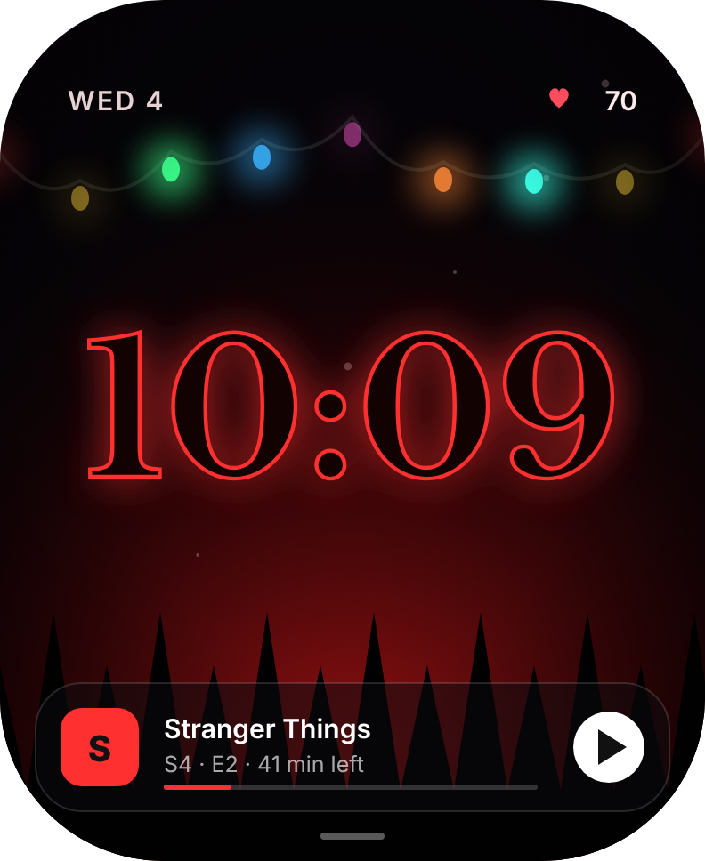 | 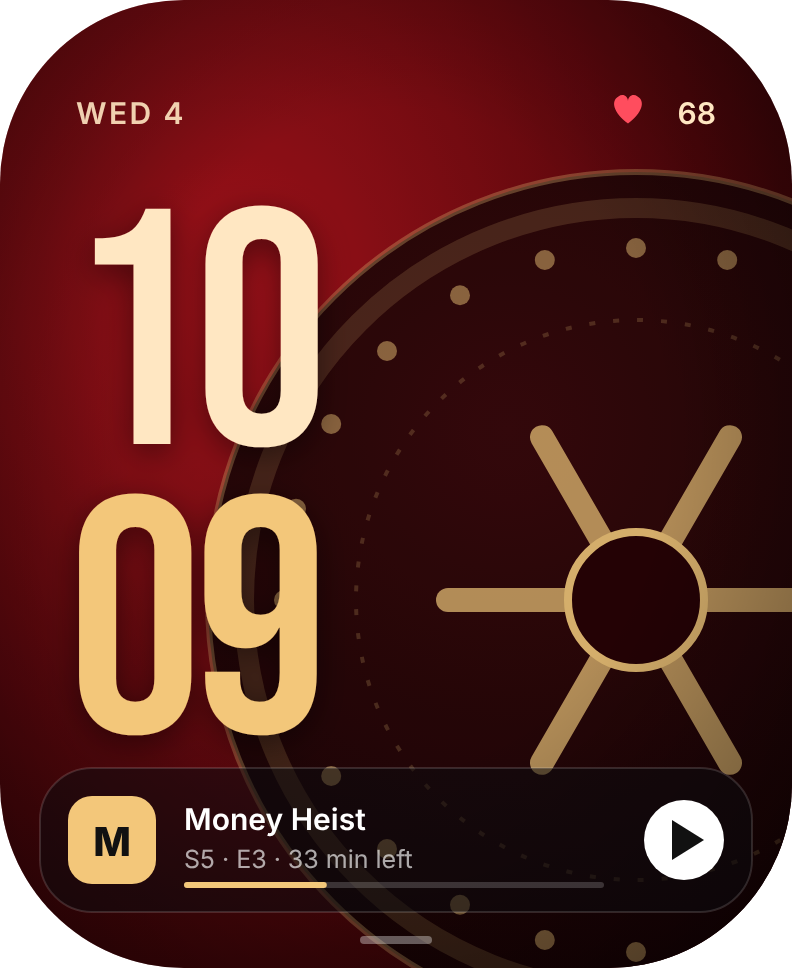 | 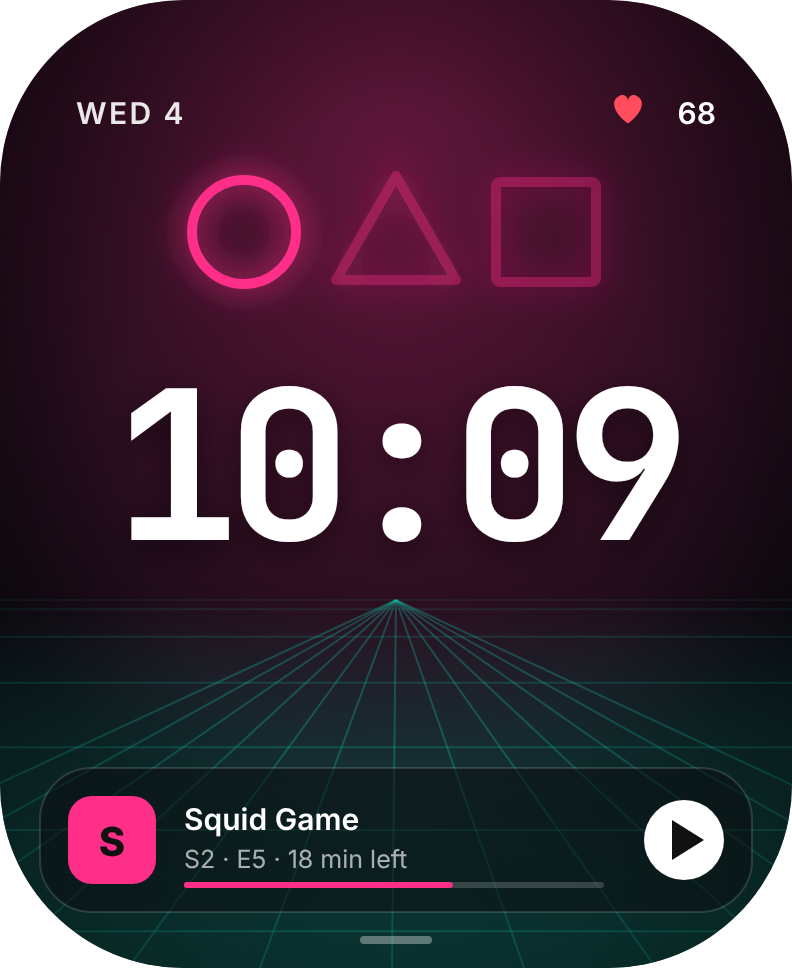 |
| Encore original | Inspired by *Friends* | Inspired by *Stranger Things* | Inspired by *Money Heist* | Inspired by *Squid Game* |

| "Rainy café, cosy" | "Neon Tokyo night" | "Calm ocean, teal" | Racing heart | Breathe |
|---|---|---|---|---|
| 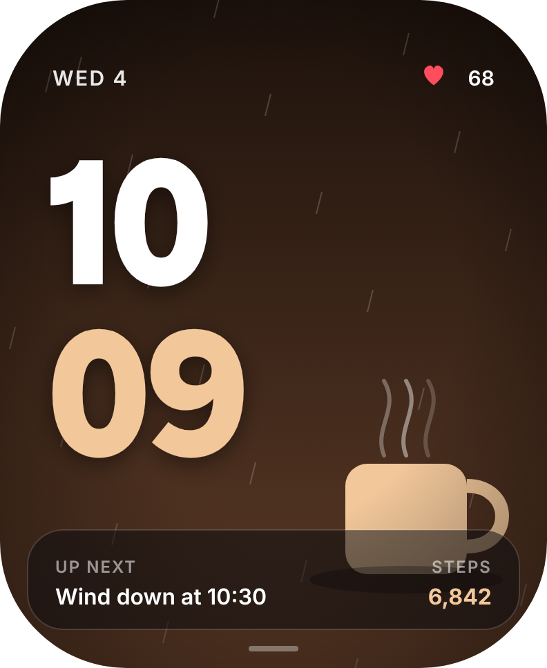 | 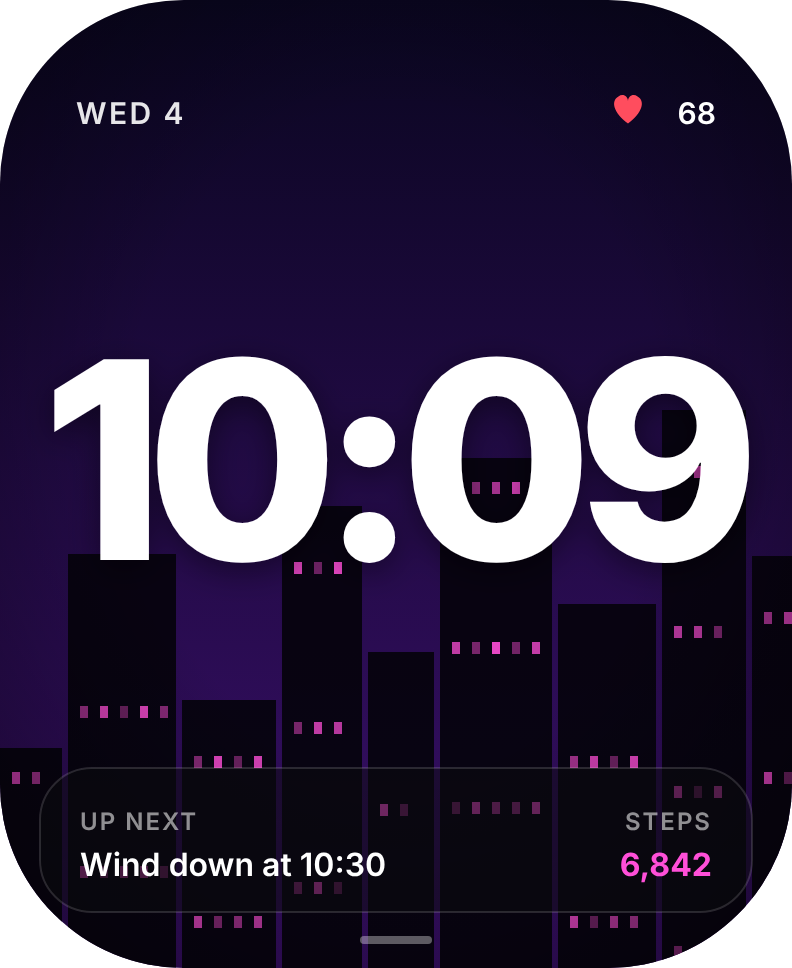 | 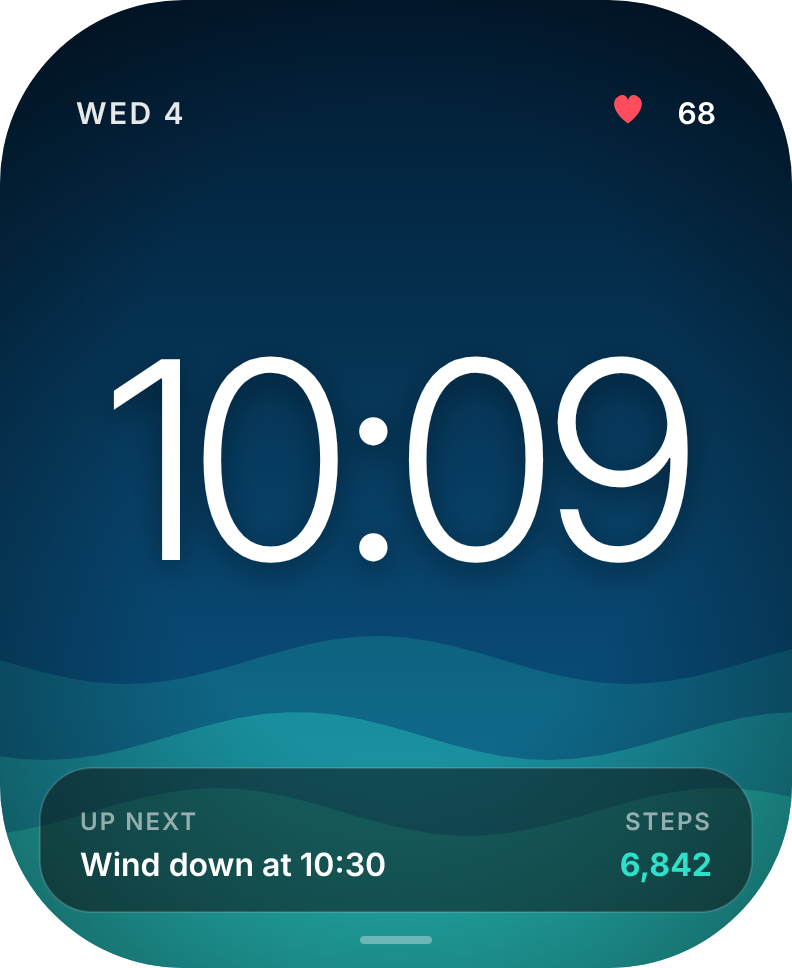 | 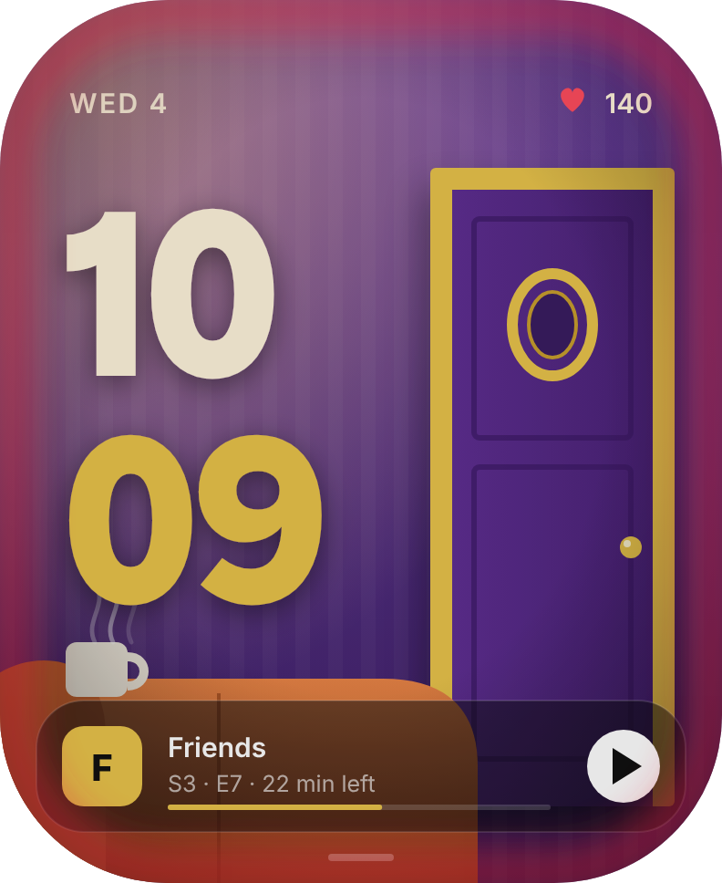 | 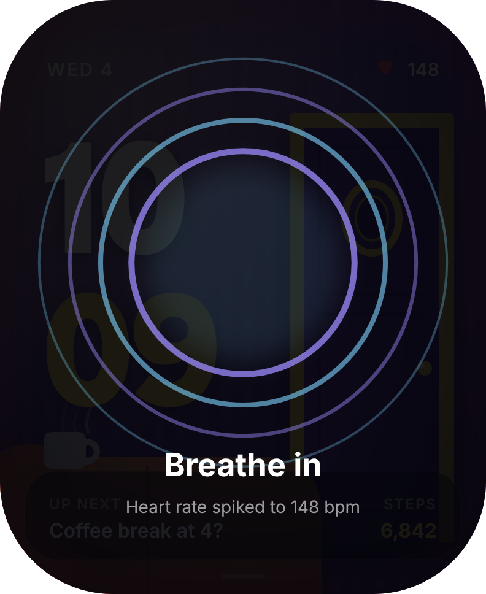 |

> All artwork is original vector illustration (a purple apartment door, fairy lights, a vault wheel, neon shapes) that evokes each show's world without logos, stills or likenesses. Official artwork would ship through studio licensing.

## Built to ship
- **Privacy:** viewing data stays on the phone, and the watch only receives finished faces. Every connection is opt-in.
- **Platforms, honestly:** on Android, automatic detection uses the system's media controls. iOS doesn't allow it, so iPhone users connect by picking shows or importing their viewing history. Netflix and Prime have no public API, and Encore doesn't need one.
- **Generator, not a gallery:** a face is built from parts (motif × palette × type × layout), so a new one takes seconds and stays sharp at any size.
- **Always-on:** true black with thin type only.

## Run it
```bash
python3 -m http.server 8123
```
Then open http://localhost:8123. Pick a show and press play, swipe the watch screen, type a description, or simulate a heart-rate spike.

Regenerate PNGs and Figma-ready SVGs (`exports/`, `figma/`):
```bash
node scripts/export.cjs http://localhost:8123/
```

## Files
- `src/faces.js`: face library (wallpaper art) and the description-to-face generator
- `src/watch.js`: watch screens (home, gallery, gift reveal, create, designing, breathe)
- `src/app.js`: interaction (swipe, flows, streaming simulation, heart sync)
- `index.html`: showcase page
