<div align="center">

# Encore.

**Watch faces that know what you love.**

You start a show and your watch gets a face made for it. Name your favourite character and it paints one around their world.
Say *"put it in a circle, a bit darker"* and it changes in a second.

[](https://www.figma.com/design/B5hYSaEPQLPnF5OnTFh9uD)
[](https://theysaid.io)
[](#run-it)
[](https://app.netlify.com/start/deploy?repository=https://github.com/Amritha902/watchface)

<sub>Watch Face Design Challenge 2026 · Open Innovation track · <i>"Think freely. Design boldly. Innovate beyond the dial."</i></sub>

<br/>

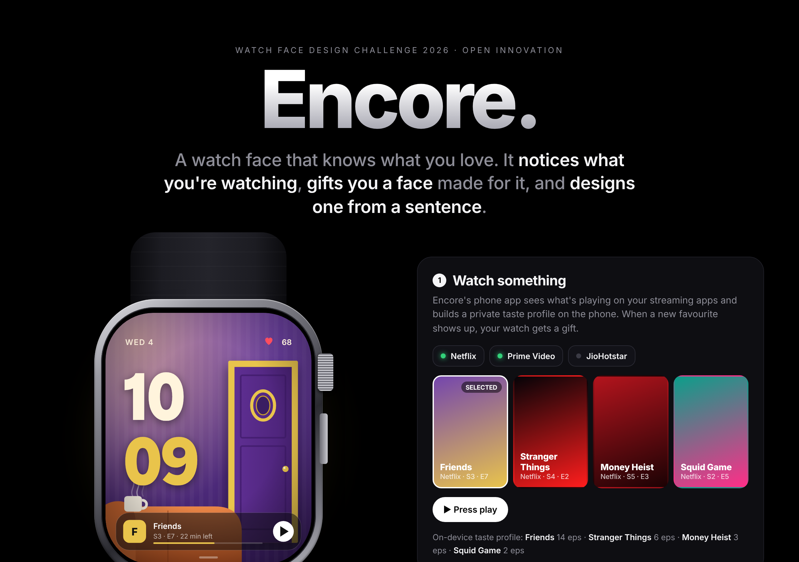

</div>

---

## Why

Your watch face is the screen you look at most, about 80 times a day. And it knows nothing about you.

Picking a face today means scrolling a gallery of near-identical dials. Meanwhile the things people actually love (the show they can't stop watching, the character they quote all week) never reach the wrist.

Encore closes that gap. It pays attention to what you watch, then **gives** you a face instead of making you go and find one.

## How it works

<table>
<tr>
<td width="50%" valign="top">

### 1 · A face shows up as a gift
Press play on *Friends* and Encore notices. A few seconds later your wrist lights up: **"Made for you · Because you're watching Friends."** The face is unwrapped with a light sweep. Wear it, or save it for later.

The face carries your show with it: episode, minutes left, and a play button that hands off to the TV.

</td>
<td width="50%" align="center">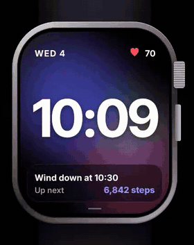</td>
</tr>
<tr>
<td align="center">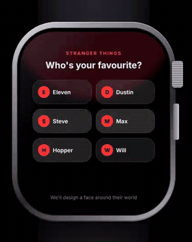</td>
<td valign="top">

### 2 · Who's your favourite?
The watch asks, and shows the cast. Tap *Eleven* and Encore designs a face around her world: the colours, the objects, the places, the mood. It doesn't copy a face or a logo.

Behind it: the cast comes from **TMDB**, **Claude** writes a style card, and an image model (**Flux**) paints the wallpaper.

</td>
</tr>
<tr>
<td valign="top">

### 3 · Swipe for more, or make your own
Swipe the face to browse your collection. The last card is always **+ Create your own**.

</td>
<td align="center">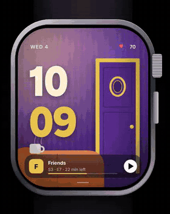</td>
</tr>
<tr>
<td align="center">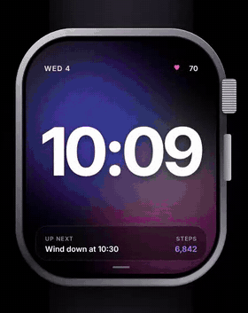</td>
<td valign="top">

### 4 · Describe it in a sentence
*"Neon Tokyo night." "A rainy café in Mumbai, warm and cosy." "Calm ocean, teal."* Say it on the watch or type it on the phone. Encore builds the face (wallpaper, palette, typeface, layout) and gifts it back.

</td>
</tr>
<tr>
<td valign="top">

### 5 · Then make it yours
Not quite right? Just say what to change.

- *"Put it in a circle"* frames the art in a medallion on a slow ray burst
- *"Clock on the left"*, *"bigger time"*, *"serif font"*
- *"Make it darker"*, *"gold accent"*, *"hide the card"*
- *"Make it rainier"* repaints the artwork itself

Claude turns the sentence into exact edits. Undo is one tap.

</td>
<td align="center"></td>
</tr>
<tr>
<td align="center">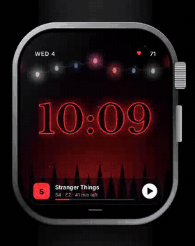</td>
<td valign="top">

### 6 · It beats with you
On every face, the heart rate pulses live. When your heart races, the edge of the screen glows red on each beat. If it **spikes** suddenly, a breathing guide takes over (4 seconds in, 6 out) until you settle.

</td>
</tr>
</table>

## The faces

**Show-inspired.** Each one is a living scene, not a static wallpaper: steam rises from the mug, the fairy lights flicker, the vault wheel turns, the shapes light up in sequence.

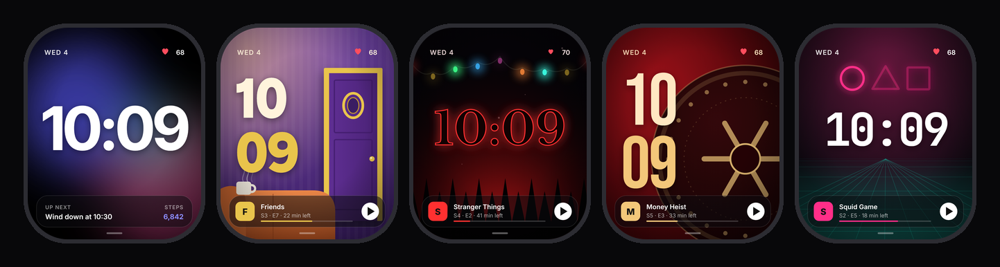

<sub>Studio · The Apartment (<i>Friends</i>) · Upside (<i>Stranger Things</i>) · The Vault (<i>Money Heist</i>) · The Game (<i>Squid Game</i>)</sub>

**Made from a sentence, or framed as a medallion.**

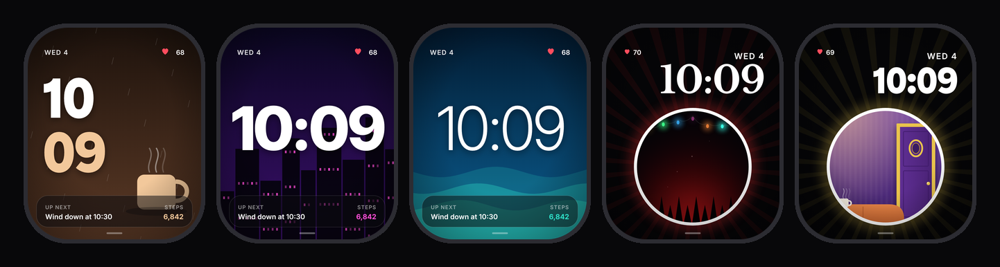

<sub>"Rainy café, cosy" · "Neon Tokyo night" · "Calm ocean, teal" · Upside in a medallion · The Apartment in a medallion</sub>

**The moments around them.**

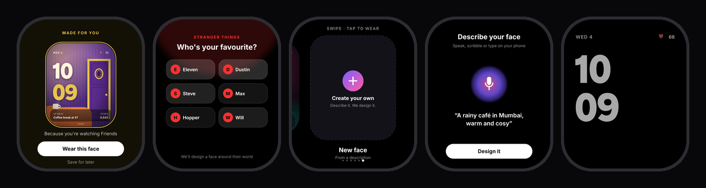

<sub>Gift reveal · Who's your favourite? · Create your own · Describe it · Always-on (true black, type only)</sub>

## Design

The full design lives in Figma: the collection, the gift and create flows, heart sync, always-on, the favourite-character quiz and the medallion frames. Everything is built as editable vectors with real type.

**→ [Open the Encore board in Figma](https://www.figma.com/design/B5hYSaEPQLPnF5OnTFh9uD)**

Some notes on the decisions:

- **Rounded-rectangle OLED, 396 × 484.** Premium smartwatch proportions, with a titanium case and a solo-loop strap in the showcase.
- **One type system, many personalities.** UI text is always Inter. The clock changes with the face: Gabarito for the sitcom warmth, Libre Baskerville with a neon outline for the 80s supernatural, Bebas Neue for the heist, JetBrains Mono for the game.
- **Glass complications.** A single frosted card at the bottom, so the art gets the rest of the screen.
- **Always-on mode drops the art entirely.** True black and thin type, which saves battery and avoids burn-in.

## Verified with TheySaid

[](https://ai.theysaid.io/projects/e1f366aa-6cbe-40e6-8886-31d353275c92)

Encore was usability-tested with **[TheySaid](https://theysaid.io)** AI testers before submission, not just checked by us. Five testers matched to the target audience (smartwatch owners aged 18–35 who binge on Netflix and Prime Video) worked through the whole product: understanding the idea, the gift reveal, the favourite-character flow, swiping to create, and editing a face.

<table>
<tr>
<td align="center"><h3>5.8 / 7</h3><sub>How premium it feels<br/>vs. their current faces</sub></td>
<td align="center"><h3>83%</h3><sub>called the gift moment<br/><b>"Delightful"</b></sub></td>
<td align="center"><h3>Top features</h3><sub><b>Describe-a-face</b> and the<br/><b>show gift</b> (tied)</sub></td>
<td align="center"><h3>3.6 / 5</h3><sub>comfortable with an app<br/>noticing what they stream</sub></td>
</tr>
</table>

<sub>Round 1, all 5 testers scored. Full report, session recordings and quotes: <a href="https://ai.theysaid.io/projects/e1f366aa-6cbe-40e6-8886-31d353275c92">TheySaid project</a>.</sub>

TheySaid's summary: *"Users grasp the concept quickly; 'made for you' feels personal, not intrusive. Create, character quiz, and preset edits are easy; character-capturing and heart-rate faces feel premium."*

### Round 2: after the fixes

We fixed everything round 1 raised, then ran the same test again on the new build with five fresh testers.

| | Round 1 | Round 2 (fixed build) | All 10 sessions |
|---|---|---|---|
| Gift moment felt **"Delightful"** | 83% | **100%** (4 of 4) | 90% |
| How premium it feels (1–7) | 5.8 | 5.75 | **5.78** |
| Comfortable with streaming-based personalisation (1–5) | 3.6 | 3.5 | 3.56 |
| Most-wanted feature | Describe-a-face / show gift (tied) | **Describe-a-face** | Describe-a-face (33%) |

<sub>Round-2 columns are worked out from TheySaid's combined totals minus round 1 (n = 4–5 per question). The intrusive vote came only in round 1.</sub>

**What it tells us:** the gift reveal is the emotional hook, and nobody in round 2 found it intrusive. Premium feel held steady at almost 6 out of 7. Describe-a-face became the clear favourite once it was easier to find. Comfort with streaming-based personalisation sits in the middle (3.5/5), which is why Encore keeps viewing data on the phone and every connection opt-in. That trust story is worth leading with.

**Next on the list, from the testers:** two or three variations per character to choose from, a clear "keep both / replace" choice when a new face arrives, and showing which parts of a description the generator will honour.

What testers liked, in their words: *"Delightful gift moment"*, *"Clear product pitch"*, *"Animated generation feels engaging"*, *"Accurate custom rendering"*, *"Battery-friendly design"*.

### Every issue they found, fixed

| What testers said | Severity | Fix shipped |
|---|---|---|
| Thought Encore was a new watch; wanted battery life and water resistance before trusting it | High | Hero now states it's a **watch-face app for the watch you already own**, plus a full **spec sheet** (compatibility, battery target, water resistance, privacy, offline) |
| Hadn't seen the watch on a wrist or from the side | High | New **On your wrist** section: the live face on a wrist, and a dimensioned side profile |
| Primary button not clearly primary | Medium | "Get a face made for you" is now the one solid button; "How it works" became an outline |
| "Try it: watch Friends" read like a demo command | Medium | New copy, plus a line explaining what happens next |
| Body text too dim on black | Medium | Raised contrast on all secondary text |
| Service chips too small to tap | Low | 44 px+ tap targets |
| Selected show easy to miss | Low | Bold white ring and solid "SELECTED" tag |
| Apply and Undo too close together | Low | Separated, with Undo restyled as a secondary action |
| *Round 1 follow-ups:* the describe box felt buried | Low | **✎ Describe your own** button right under the watch |
| "Design it" and "Use your own photo" side by side confused people | Low | Photo moved to its own "Or start from a picture" row |
| Didn't realise Undo can go back more than one step | Low | Undo shows the steps left, e.g. **Undo (2)** |
| The heart-rate spike demo wasn't self-explanatory | Low | One-line explanation of what the button simulates |
| Wanted compatibility before anything else | Medium | "Works on Wear OS 4+" in the hero, linked to the spec sheet |

TheySaid's first design scan also caught a missing "start here" button *before* the full test. We fixed that first, so testers reacted to the improved build.

<p align="center">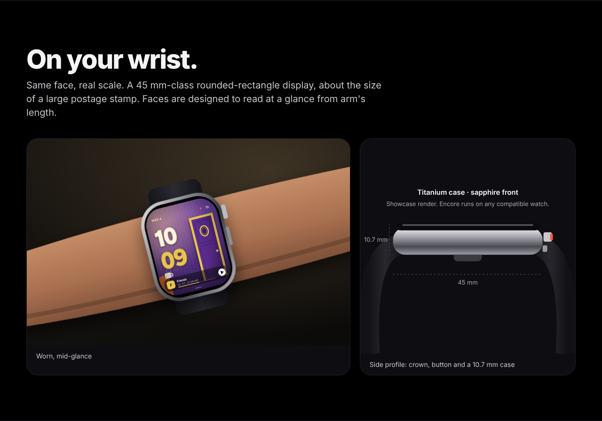</p>
<p align="center">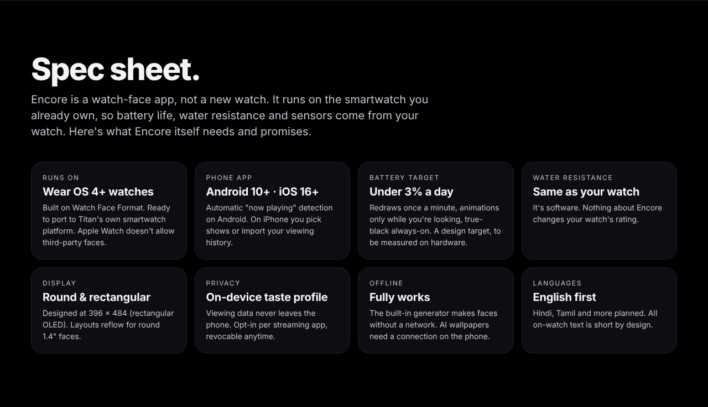</p>

## Under the hood

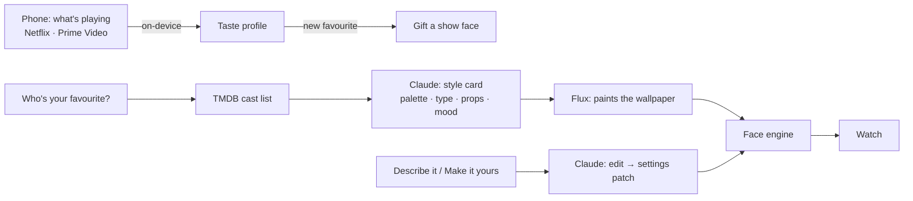

| Piece | What it does |
|---|---|
| `src/faces.js` | Face library and art, the sentence-to-face generator, style-card faces, and the edit engine |
| `src/watch.js` | Every watch screen: home, gallery, gift, quiz, create, designing, breathe |
| `src/app.js` | Interactions: swipe, streaming simulation, favourite character, edits with undo, heart sync |
| `server/index.mjs` | Small Node server: TMDB cast lists, Claude style cards and edits (structured JSON), Flux wallpapers via Replicate |
| `dist/encore.html` | The whole prototype in one file, no server needed |

**Every AI step has an offline fallback.** With no API keys, a built-in generator takes over and the whole demo still works. Keys stay on the server, never in the browser.

## Built to ship

- **Private by design.** Viewing data never leaves the phone. The watch only ever receives finished faces. Every connection is opt-in.
- **Honest about platforms.** On Android, a companion app can read what's playing through the system's media controls, with permission. iOS doesn't allow this, so iPhone users pick shows or import their viewing history. Neither Netflix nor Prime Video has a public API, and Encore doesn't need one.
- **Rights-aware.** Show faces and AI wallpapers evoke a character's world (objects, places, colour) and never reproduce actors, logos or studio art. Official artwork is a licensing conversation, and a natural partnership for a watch brand.
- **Light on the watch.** Faces are vectors plus one optional image. Generation happens on the phone or server, not the wrist.

## Run it

```bash
npm install
```
```bash
cp .env.example .env
```

Add any keys you have to `.env`. All are optional:

| Key | Unlocks |
|---|---|
| `ANTHROPIC_API_KEY` | Claude style cards and plain-language edits |
| `REPLICATE_API_TOKEN` | AI-painted wallpapers (Flux) |
| `TMDB_API_KEY` | Live cast lists for any show |

```bash
npm start
```

Then open **http://localhost:8787**. Or just open `dist/encore.html` in a browser.

**Host it:** the repo includes `netlify.toml`, so importing it on Netlify (or the Deploy button above) publishes the single-file demo with no server and no keys.

<details>
<summary>Regenerating the images and animations</summary>

With the server running:

```bash
node scripts/export.cjs
```
```bash
node scripts/record-gifs.cjs
```
```bash
node scripts/bundle.cjs
```

These produce `exports/` (PNG renders), `figma/` (Figma-ready SVGs), `docs/` (README animations) and `dist/encore.html`.
</details>

---

<div align="center">
<sub>Designed and built by <b>Amritha S</b> · Watch Face Design Challenge 2026</sub>
</div>
