<div align="center">

# Encore.

**Ten original watch faces, and the idea that ties them together:<br/>a watch face that knows what you love.**

[](https://www.figma.com/design/B5hYSaEPQLPnF5OnTFh9uD)
[](https://ai.theysaid.io/projects/e1f366aa-6cbe-40e6-8886-31d353275c92)
[](https://encore-watch-faces.onrender.com)
[](docs/encore-demo.mp4)

<sub>Titan Watch Face Design Challenge 2026 · Open Innovation · <i>"Think freely. Design boldly. Innovate beyond the dial."</i></sub>

<br/>

<a href="docs/encore-demo.mp4">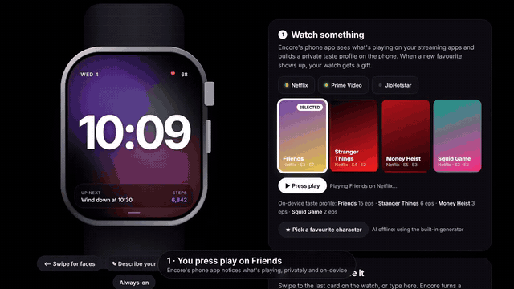</a>

<sub>▶ <a href="docs/encore-demo.mp4"><b>Watch the 85-second demo</b></a> (gift reveal → favourite character → swipe → describe → edit → heart sync → the full collection) · or <a href="https://encore-watch-faces.onrender.com">try it live</a></sub>

</div>

---

## The collection

Ten designs, each a separate submission with its own Figma frames (Active, Always-On, Interactive), all at the Titan kit size of **368 × 448**, with text at 21 px or larger and icons at 25 px or larger.

<table>
<tr><td width="50%" align="center">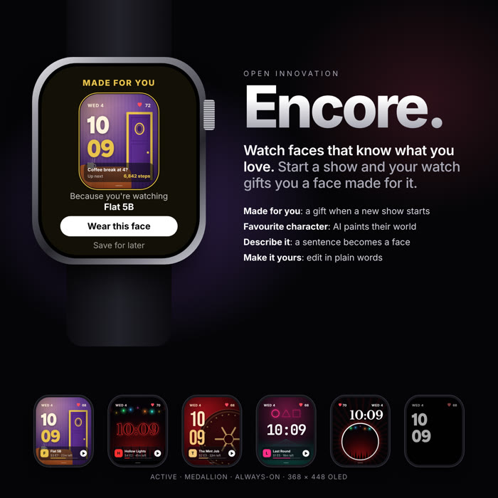<br/><b>01 · Encore</b> <sub>· Personalised entertainment</sub><br/><sub>Your watch gifts you a face for the show you just started.</sub></td><td width="50%" align="center">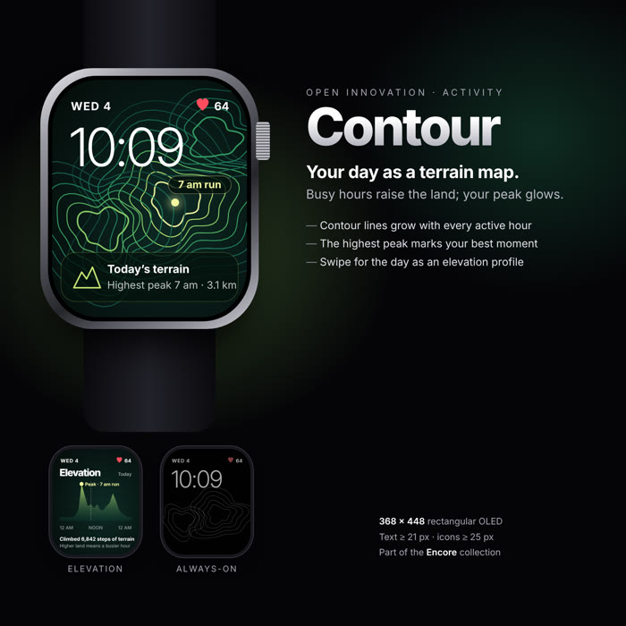<br/><b>02 · Contour</b> <sub>· Activity</sub><br/><sub>Your day as a terrain map; your busiest hour is the peak.</sub></td></tr>
<tr><td width="50%" align="center">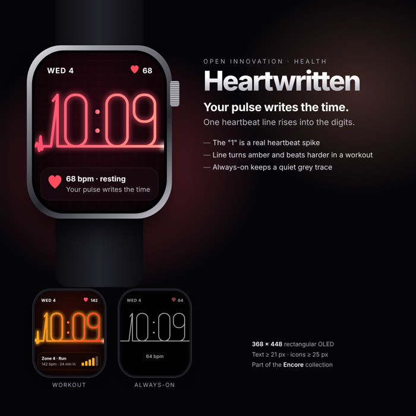<br/><b>03 · Heartwritten</b> <sub>· Heart rate</sub><br/><sub>One heartbeat line rises into the digits of the time.</sub></td><td width="50%" align="center">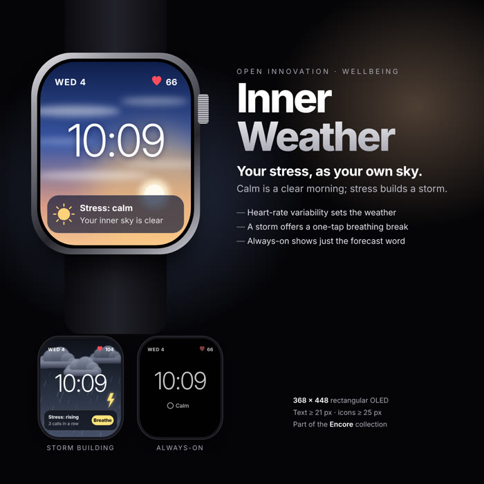<br/><b>04 · Inner Weather</b> <sub>· Stress</sub><br/><sub>Your stress level, shown as your own sky.</sub></td></tr>
<tr><td width="50%" align="center">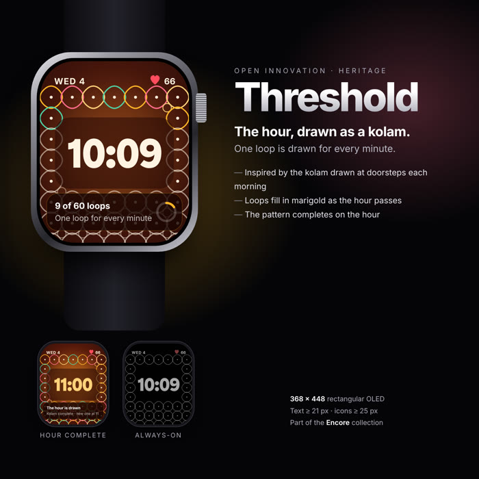<br/><b>05 · Threshold</b> <sub>· Heritage</sub><br/><sub>A kolam frames the time; one loop fills per minute.</sub></td><td width="50%" align="center">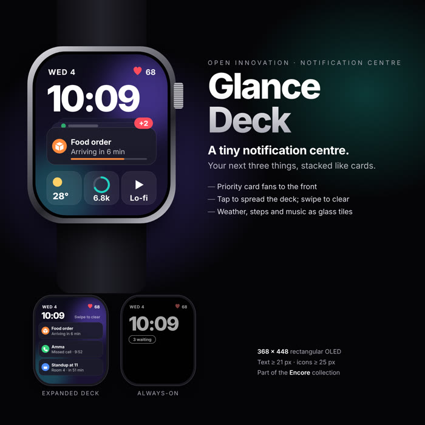<br/><b>06 · Glance Deck</b> <sub>· Notification centre</sub><br/><sub>Your next three things, stacked like cards.</sub></td></tr>
<tr><td width="50%" align="center">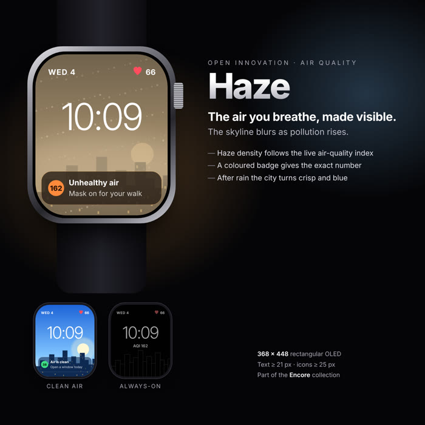<br/><b>07 · Haze</b> <sub>· Air quality</sub><br/><sub>The skyline blurs as the air gets worse.</sub></td><td width="50%" align="center">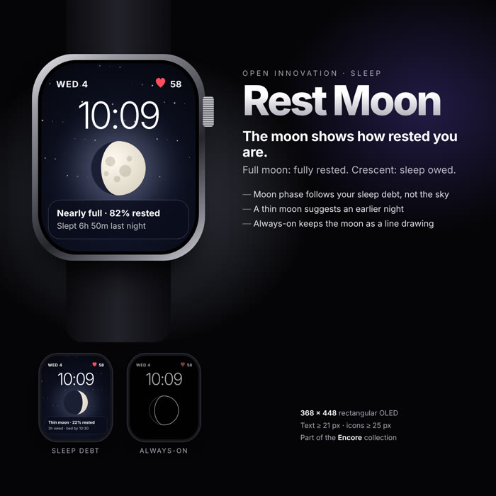<br/><b>08 · Rest Moon</b> <sub>· Sleep</sub><br/><sub>The moon phase shows how rested you are.</sub></td></tr>
<tr><td width="50%" align="center">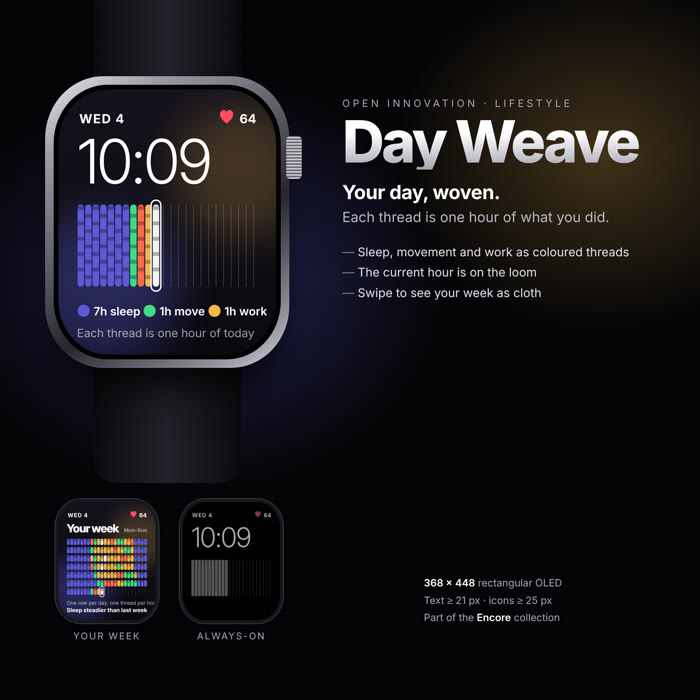<br/><b>09 · Day Weave</b> <sub>· Habits</sub><br/><sub>Your day woven as cloth, one thread per hour.</sub></td><td width="50%" align="center">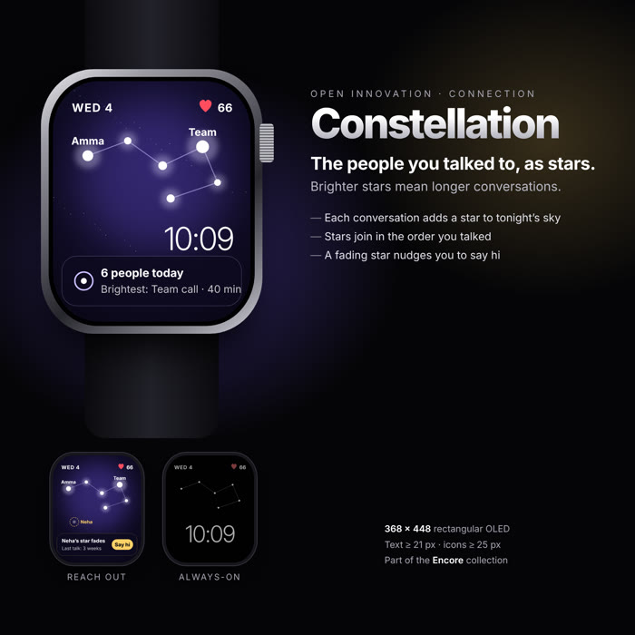<br/><b>10 · Constellation</b> <sub>· Connection</sub><br/><sub>People you talked to today, as stars.</sub></td></tr>
</table>

Every design in this repo is ready to submit: [`submission/`](submission/) holds one folder and one zip per entry (preview, frames at 3x, editable SVGs, description), and [`submission/ENTRIES.md`](submission/ENTRIES.md) has the text to paste for all ten.

## Why

Your watch face is the screen you look at most, about 80 times a day, and it knows nothing about you. Picking one today means scrolling a gallery of near-identical dials. The things people actually love (the show they can't stop watching, the match they're following, the ride they're on) never reach the wrist.

**Encore** closes that gap. It pays attention, then *gives* you a face instead of making you go and find one. The other nine designs push the same idea in different directions: a live score, a commute, a notification deck, a battery you can read from across the room.

## How Encore works

<table>
<tr>
<td width="50%" valign="top">

### 1 · A face shows up as a gift
Press play on a show and Encore notices. A few seconds later your wrist lights up: **"Made for you · Because you're watching Flat 5B."** The face is unwrapped with a light sweep. Wear it, or save it for later. It carries your show with it: episode, minutes left, and a play button that hands off to the TV.

</td>
<td width="50%" align="center"></td>
</tr>
<tr>
<td align="center"></td>
<td valign="top">

### 2 · Who's your favourite?
The watch shows the cast. Tap a character and Encore designs a face around their world: colours, objects, places, mood. It never copies a face or a logo. Behind it, the cast comes from **TMDB**, **Claude** writes a style card and **Flux** paints the wallpaper.

</td>
</tr>
<tr>
<td valign="top">

### 3 · Swipe for more, or make your own
Swipe the face to browse your collection. The last card is always **+ Create your own**.

</td>
<td align="center"></td>
</tr>
<tr>
<td align="center"></td>
<td valign="top">

### 4 · Describe it in a sentence
*"Neon Tokyo night." "A rainy café in Mumbai, warm and cosy."* Encore builds the wallpaper, palette, typeface and layout, then gifts it back.

</td>
</tr>
<tr>
<td valign="top">

### 5 · Then make it yours
*"Put it in a circle"*, *"clock on the left"*, *"darker"*, *"gold accent"*, *"serif"*, *"repaint it rainier"*. Claude turns the sentence into exact edits, and Undo steps back one change at a time.

</td>
<td align="center"></td>
</tr>
<tr>
<td align="center"></td>
<td valign="top">

### 6 · It beats with you
Heart rate pulses live on every face. When your heart races, the screen edge glows red on each beat; after a sudden spike, a breathing guide takes over.

</td>
</tr>
</table>

## Design in Figma

**→ [Open the Encore file](https://www.figma.com/design/B5hYSaEPQLPnF5OnTFh9uD)** · **→ [Match Day file](https://www.figma.com/design/IDcHaADMOicH5pN6GQjgzT)** · other entries import in a minute from their `frames-svg/` folders.

Frames are named by state, as the brief asks: `Active Display`, `Always-On`, `Interactive · …`. Everything is vector with live text.

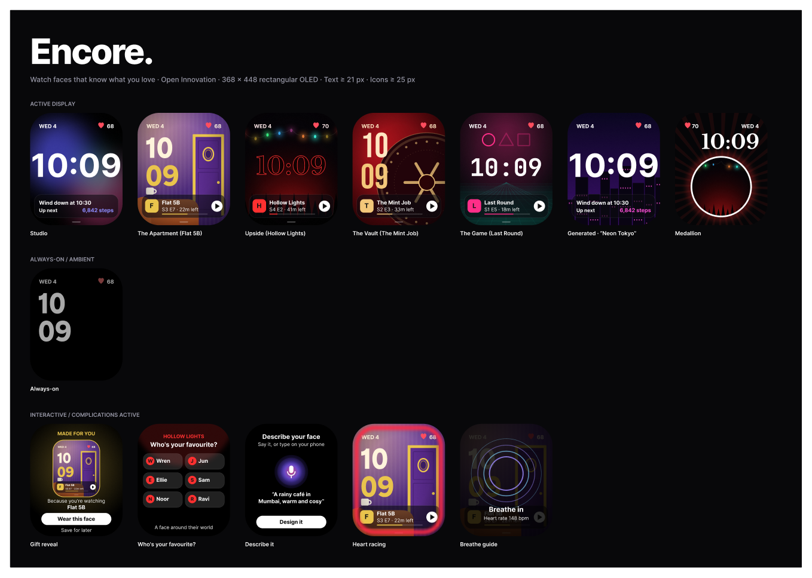

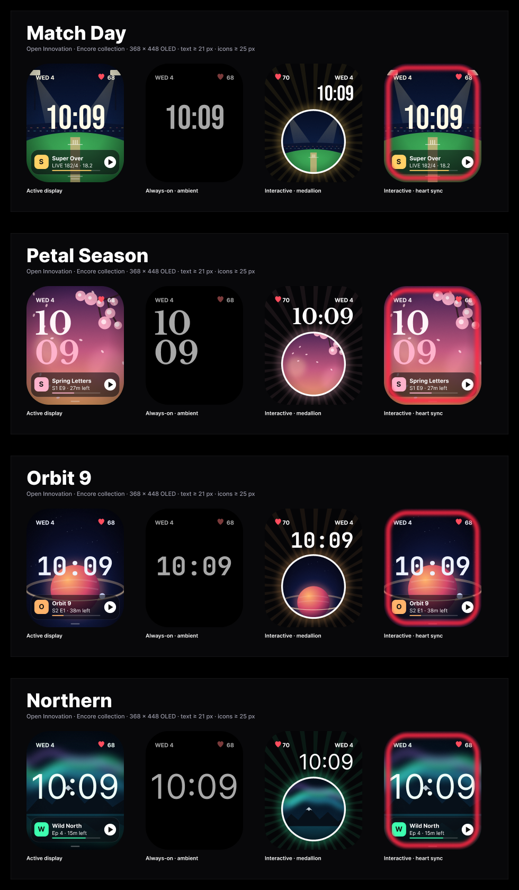

**Design rules we followed (from the Titan design kit):**
- **368 × 448** rectangular OLED, one of the kit's listed sizes.
- **Text ≥ 21 px, icons ≥ 25 px.** The time is always the largest element and reads in about a second.
- **No brand logos** on any face, and **only fictional** show, character and place names. All artwork is original vector illustration.
- **Always-on** for every design: true black, type and thin lines only.
- Commercially free fonts only: Inter, Inter Tight, Gabarito, Libre Baskerville, Bebas Neue, JetBrains Mono (Google Fonts, OFL).

## Verified with TheySaid

[](https://ai.theysaid.io/projects/e1f366aa-6cbe-40e6-8886-31d353275c92)

Encore was usability-tested with **[TheySaid](https://theysaid.io)** AI testers before submission, not just checked by us. Five testers matched to the target audience (smartwatch owners aged 18–35 who binge on Netflix and Prime Video) worked through the whole product: understanding the idea, the gift reveal, the favourite-character flow, swiping to create, and editing a face.

<table>
<tr>
<td align="center"><h3>5.8 / 7</h3><sub>How premium it feels<br/>vs. their current faces</sub></td>
<td align="center"><h3>83%</h3><sub>called the gift moment<br/><b>"Delightful"</b></sub></td>
<td align="center"><h3>Top features</h3><sub><b>Describe-a-face</b> and the<br/><b>show gift</b> (tied)</sub></td>
<td align="center"><h3>3.6 / 5</h3><sub>comfortable with an app<br/>noticing what they stream</sub></td>
</tr>
</table>

<sub>Round 1, all 5 testers scored. Full report, session recordings and quotes: <a href="https://ai.theysaid.io/projects/e1f366aa-6cbe-40e6-8886-31d353275c92">TheySaid project</a>.</sub>

TheySaid's summary: *"Users grasp the concept quickly; 'made for you' feels personal, not intrusive. Create, character quiz, and preset edits are easy; character-capturing and heart-rate faces feel premium."*

### Round 2: after the fixes

We fixed everything round 1 raised, then ran the same test again on the new build with five fresh testers.

| | Round 1 | Round 2 (fixed build) | All 10 sessions |
|---|---|---|---|
| Gift moment felt **"Delightful"** | 83% | **100%** (4 of 4) | 90% |
| How premium it feels (1–7) | 5.8 | 5.75 | **5.78** |
| Comfortable with streaming-based personalisation (1–5) | 3.6 | 3.5 | 3.56 |
| Most-wanted feature | Describe-a-face / show gift (tied) | **Describe-a-face** | Describe-a-face (33%) |

<sub>Round-2 columns are worked out from TheySaid's combined totals minus round 1 (n = 4–5 per question). The intrusive vote came only in round 1.</sub>

**What it tells us:** the gift reveal is the emotional hook, and nobody in round 2 found it intrusive. Premium feel held steady at almost 6 out of 7. Describe-a-face became the clear favourite once it was easier to find. Comfort with streaming-based personalisation sits in the middle (3.5/5), which is why Encore keeps viewing data on the phone and every connection opt-in. That trust story is worth leading with.

**Next on the list, from the testers:** two or three variations per character to choose from, a clear "keep both / replace" choice when a new face arrives, and showing which parts of a description the generator will honour.

What testers liked, in their words: *"Delightful gift moment"*, *"Clear product pitch"*, *"Animated generation feels engaging"*, *"Accurate custom rendering"*, *"Battery-friendly design"*.

### Every issue they found, fixed

| What testers said | Severity | Fix shipped |
|---|---|---|
| Thought Encore was a new watch; wanted battery life and water resistance before trusting it | High | Hero now states it's a **watch-face app for the watch you already own**, plus a full **spec sheet** (compatibility, battery target, water resistance, privacy, offline) |
| Hadn't seen the watch on a wrist or from the side | High | New **On your wrist** section: the live face on a wrist, and a dimensioned side profile |
| Primary button not clearly primary | Medium | "Get a face made for you" is now the one solid button; "How it works" became an outline |
| The first button read like a demo command | Medium | New copy, plus a line explaining what happens next |
| Body text too dim on black | Medium | Raised contrast on all secondary text |
| Service chips too small to tap | Low | 44 px+ tap targets |
| Selected show easy to miss | Low | Bold white ring and solid "SELECTED" tag |
| Apply and Undo too close together | Low | Separated, with Undo restyled as a secondary action |
| *Round 1 follow-ups:* the describe box felt buried | Low | **✎ Describe your own** button right under the watch |
| "Design it" and "Use your own photo" side by side confused people | Low | Photo moved to its own "Or start from a picture" row |
| Didn't realise Undo can go back more than one step | Low | Undo shows the steps left, e.g. **Undo (2)** |
| The heart-rate spike demo wasn't self-explanatory | Low | One-line explanation of what the button simulates |
| Wanted compatibility before anything else | Medium | "Works on Wear OS 4+" in the hero, linked to the spec sheet |

TheySaid's first design scan also caught a missing "start here" button *before* the full test. We fixed that first, so testers reacted to the improved build.

<p align="center"></p>
<p align="center"></p>

## Under the hood

The designs are backed by a working prototype, so the interactions in the video are real.

| Piece | What it does |
|---|---|
| `src/faces.js` | Face art and the sentence-to-face generator, style-card faces, edit engine |
| `src/concepts.js` | Glance Deck (every state) |
| `src/concepts3.js` | Contour, Haze, Rest Moon, Constellation (every state) |
| `src/concepts2.js` | Heartwritten, Inner Weather, Threshold, Day Weave (every state) |
| `src/watch.js` | Watch screens: home, gallery, gift, quiz, create, designing, breathe |
| `src/app.js` | Interactions: swipe, streaming simulation, favourite character, edits with undo, heart sync |
| `server/index.mjs` | TMDB cast lists, Claude style cards and edits, Flux wallpapers (all optional, offline fallback) |
| `scripts/` | Exports, Figma SVGs, submission packages, README GIFs and the demo video |

```bash
npm install
```
```bash
npm start
```
Open **http://localhost:8787**, or just open `dist/encore.html`. Optional keys go in `.env` (see `.env.example`): `ANTHROPIC_API_KEY`, `REPLICATE_API_TOKEN`, `TMDB_API_KEY`.

---

<div align="center">
<sub>Designed and built by <b>Amritha S</b> · Titan Watch Face Design Challenge 2026</sub>
</div>
